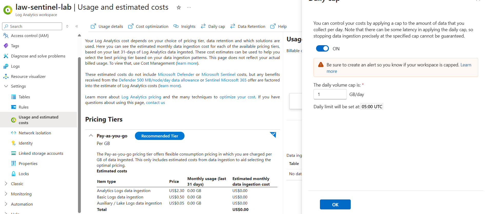
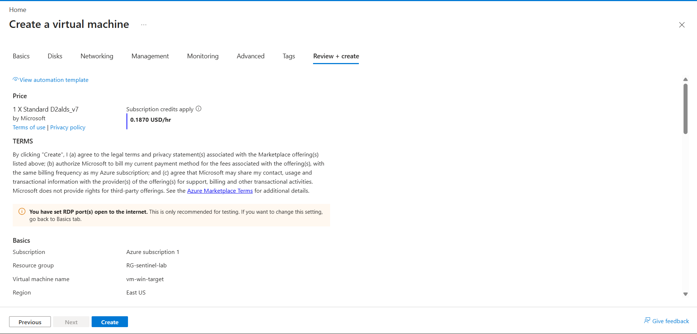
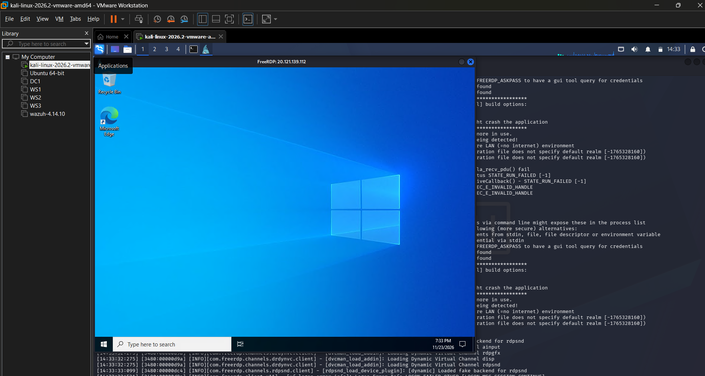
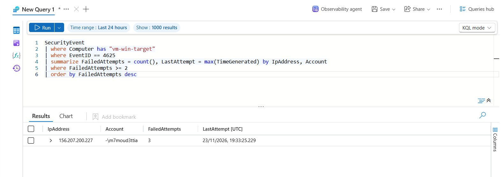
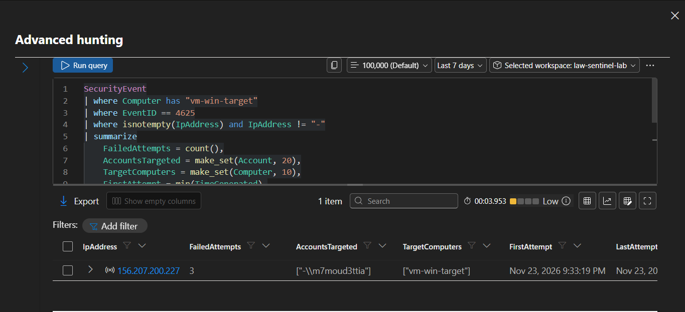
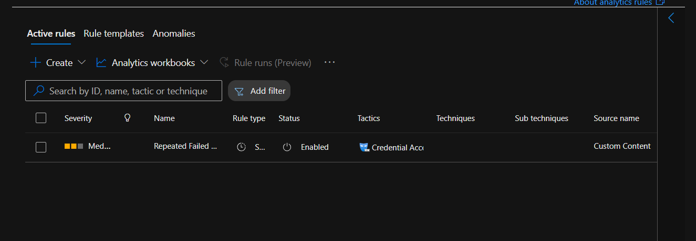
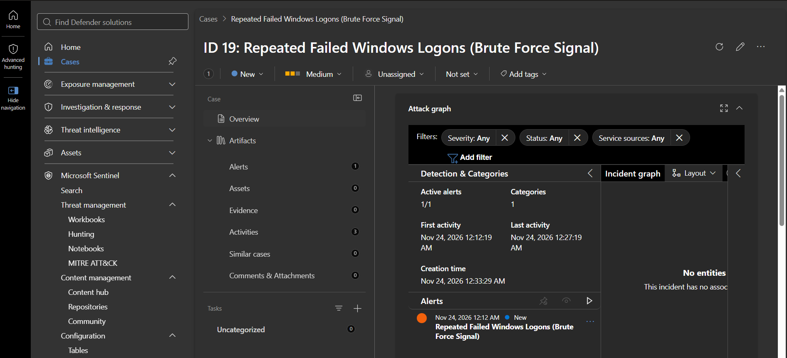

## Overview

In this part of the **Azure Cloud SOC Lab**, I set up the core Azure foundation under `RG-sentinel-lab` (`East US`), deployed a Log Analytics workspace (`law-sentinel-lab`) with a daily ingestion cap and Microsoft Sentinel, provisioned the Windows Server 2022 target machine (`vm-win-target`), connected it via a Data Collection Rule (`dcr-win-security-lab`), simulated failed and successful RDP logons from Kali Linux, validated the incoming telemetry with KQL, and built a **Scheduled Analytics Rule** mapped to **MITRE ATT&CK** to detect repeated failed logons and generate incidents for SOC triage.

## 1. Azure Foundation, Log Analytics & Sentinel

I started by organizing the lab resources under a dedicated resource group (`RG-sentinel-lab`) in `East US` so all lab components stay isolated and easy to manage or clean up.

{: .normal }

Next, I deployed the Log Analytics workspace (`law-sentinel-lab`) inside `RG-sentinel-lab` to act as the underlying log storage engine for Microsoft Sentinel.

{: .normal }

To prevent unexpected ingestion charges during testing, I enabled a daily ingestion cap on `law-sentinel-lab` to control daily log volume.

{: .normal }

Finally, I onboarded **Microsoft Sentinel** onto `law-sentinel-lab` to enable threat hunting, KQL analytics, and incident management.

{: .normal }

## 2. Target VM Provisioning & RDP Hardening

I provisioned `vm-win-target` (Windows Server 2022 Datacenter, `Standard_D2alds_v7`) inside `RG-sentinel-lab` as the controlled target host, and restricted inbound RDP (`TCP/3389`) on its Network Security Group to my source IP address rather than exposing it to `Any`.

{: .normal }

## 3. Connecting `vm-win-target` to Sentinel via AMA & DCR

After installing the **Windows Security Events** solution from Content Hub, I created a Data Collection Rule (`dcr-win-security-lab`) under **Windows Security Events via AMA** associated with `vm-win-target` so Windows security events stream into `law-sentinel-lab`.

{: .normal }

## 4. Attack Simulation from Kali Linux

Using `FreeRDP` from Kali Linux, I tested failed authentication attempts followed by a successful RDP logon to `vm-win-target` (`20.121.139.112`) to generate realistic Windows authentication logs (`Event ID 4625` for failed logons and `Event ID 4624` for successful logons).

{: .normal }

## 5. Validating Telemetry & Failed Logon Patterns with KQL

Once events arrived in `law-sentinel-lab`, I queried `SecurityEvent` in **Logs** to verify individual `4625` and `4624` records along with `Account`, `IpAddress`, and `LogonType`.

~~~kusto
SecurityEvent
| where Computer has "vm-win-target"
| where EventID in (4624, 4625)
| project TimeGenerated, EventID, Activity, Account, IpAddress, LogonType
| order by TimeGenerated desc
~~~

{: .normal }

I then aggregated failed logon attempts (`EventID == 4625`) by `IpAddress` and `Account` to group repeated authentication failures—the foundational logic for a brute-force detection rule.

~~~kusto
SecurityEvent
| where Computer has "vm-win-target"
| where EventID == 4625
| summarize FailedAttempts = count(), LastAttempt = max(TimeGenerated) by IpAddress, Account
| where FailedAttempts >= 2
| order by FailedAttempts desc
~~~

{: .normal }

## 6. Scheduled Analytics Rule & MITRE ATT&CK Mapping

With telemetry ingestion and KQL logic validated, I transitioned from manual log hunting to automated detection by creating a **Scheduled query rule** named **`Repeated Failed Windows Logons (Brute Force Signal)`** in Microsoft Sentinel.

### MITRE ATT&CK Alignment

* **Tactic — Credential Access (`TA0006`):** Repeated failed authentication attempts over RDP indicate an adversary attempting to obtain valid account credentials to access `vm-win-target`.
* **Technique — Brute Force (`T1110`):** Specifically aligns with **Password Guessing (`T1110.001`)** when testing multiple passwords against a targeted user account, or **Password Spraying (`T1110.003`)** when trying common passwords across multiple accounts.
* **Severity (`Medium`):** Configured as an early high-signal detection (`FailedAttempts >= 3`) that alerts analysts to brute-force activity before or alongside potential follow-on compromise (`EventID 4624`).

### Rule Query & Logic

The scheduled detection rule queries `SecurityEvent` on `vm-win-target` for failed logons (`EventID == 4625`) with valid non-empty source IPs, summarizes attempts per `IpAddress`, and triggers when `FailedAttempts >= 3`:

~~~kusto
SecurityEvent
| where Computer has "vm-win-target"
| where EventID == 4625
| where isnotempty(IpAddress) and IpAddress != "-"
| summarize
    FailedAttempts = count(),
    AccountsTargeted = make_set(Account, 20),
    TargetComputers = make_set(Computer, 10),
    FirstAttempt = min(TimeGenerated),
    LastAttempt = max(TimeGenerated)
  by IpAddress
| where FailedAttempts >= 3
| extend AccountName = tostring(AccountsTargeted[0]), HostName = tostring(TargetComputers[0])
~~~

{: .normal }

### Scheduling & Rule Activation

To balance timely detection with query efficiency, the rule was configured with the following parameters:

* **Run query every:** `5 Minutes`
* **Lookup data from the last:** `15 Minutes`
* **Alert threshold:** `Generate alert when number of query results` → `Is greater than 0`
* **Event grouping:** `Trigger an alert for each event` (`Suppression`: `Off`)
* **Incident settings:** Enabled automatic incident creation from generated alerts.

{: .normal }

## 7. Incident Generation & Analyst Triage (`Case ID 19`)

After simulating repeated failed RDP logons from Kali Linux (`156.207.200.227`) against `vm-win-target`, Microsoft Sentinel triggered the rule and generated **Case `ID 19: Repeated Failed Windows Logons (Brute Force Signal)`** with **Medium** severity, **New** status, `1` active alert (`1/1`), and `3` recorded activities.

{: .normal }

### Triage Takeaways

1. **Timeline & Activity Verification:** Inspecting `Alerts (1)` and `Activities (3)` confirmed the exact burst window (`Nov 24, 2026 12:12:19 AM` to `12:27:19 AM`), targeted account (`m7moud3ttia`), and host (`vm-win-target`).
2. **Correlation with Successful Logons (`4624`):** During real SOC triage, the immediate next check is querying `EventID == 4624` from the same source IP to verify whether any attempt succeeded.
3. **Entity Mapping Enhancement:** As shown in the incident view (`No entities` under `Incident graph` and `Assets: 0`), mapping output fields (`IpAddress`, `AccountName`, `HostName`) in the rule's **Entity mapping** section ensures IP, account, and host entities populate directly into the investigation graph.

## What's Next

With end-to-end telemetry ingestion, **MITRE ATT&CK**-mapped scheduled detection rules, and incident generation working in **Microsoft Sentinel**, the next step in the lab is enriching detections with **Entity Mapping**, building correlation rules for **Brute Force Followed by Successful Logon (`4625` → `4624`)**, and automating response workflows with **Microsoft Sentinel Playbooks (Logic Apps)**.
