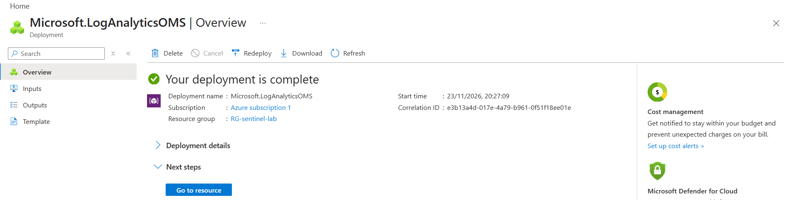
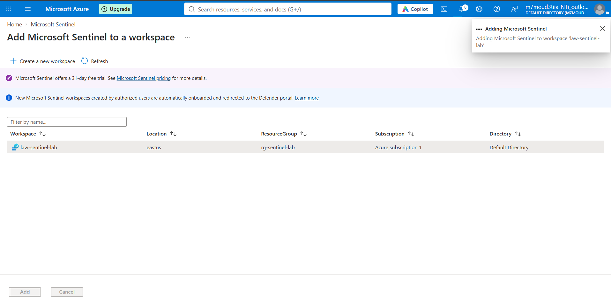

## Overview

In this part of the **Azure Cloud SOC Lab**, I set up the core Azure foundation under `RG-sentinel-lab` (`East US`)[cite: 18], deployed Log Analytics (`law-sentinel-lab`) with a daily ingestion cap and Microsoft Sentinel[cite: 20, 21, 23], provisioned the Windows Server 2022 target machine (`vm-win-target`)[cite: 19], connected it via a Data Collection Rule (`dcr-win-security-lab`)[cite: 17], simulated failed and successful RDP logons from Kali Linux[cite: 24], and validated the incoming telemetry with KQL[cite: 16, 22].

## 1. Azure Foundation, Log Analytics & Sentinel

I started by organizing the lab resources under `RG-sentinel-lab` in `East US`[cite: 18], deploying the Log Analytics workspace (`law-sentinel-lab`)[cite: 20, 23], configuring a daily cap to keep lab costs controlled[cite: 20], and onboarding Microsoft Sentinel onto the workspace[cite: 21].

{: .normal }[cite: 18, 25]

{: .normal }[cite: 23, 25]

{: .normal }[cite: 20, 25]

{: .normal }[cite: 21, 25]

## 2. Target VM Provisioning & RDP Hardening

Next, I provisioned `vm-win-target` (Windows Server 2022 Datacenter, `Standard_D2alds_v7`) in `RG-sentinel-lab`[cite: 19] and restricted inbound RDP (`TCP/3389`) access on its NSG to my source IP address rather than leaving it open to `Any`[cite: 9].

{: .normal }[cite: 19, 25]

## 3. Connecting `vm-win-target` to Sentinel via AMA & DCR

With the **Windows Security Events** solution installed, I created `dcr-win-security-lab` under **Windows Security Events via AMA** targeting `vm-win-target` so security events stream into `law-sentinel-lab`[cite: 17].

{: .normal }[cite: 17, 25]

## 4. Attack Simulation from Kali Linux

From Kali Linux (`FreeRDP`), I simulated failed login attempts followed by a successful RDP logon to `vm-win-target` (`20.121.139.112`) to generate authentic Windows Security authentication logs (`Event ID 4625` and `Event ID 4624`)[cite: 9, 24].

{: .normal }[cite: 24, 25]

## 5. Validating Telemetry & Failed Logon Patterns with KQL

Once logs arrived in `law-sentinel-lab`, I queried `SecurityEvent` in **Logs** to inspect individual `4625` and `4624` records along with `Account`, `IpAddress`, and `LogonType`[cite: 14, 22].

```kusto
SecurityEvent
| where Computer has "vm-win-target"
| where EventID in (4624, 4625)
| project TimeGenerated, EventID, Activity, Account, IpAddress, LogonType
| order by TimeGenerated desc
