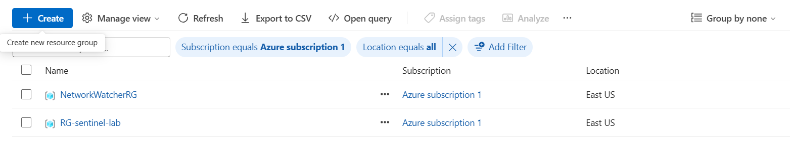
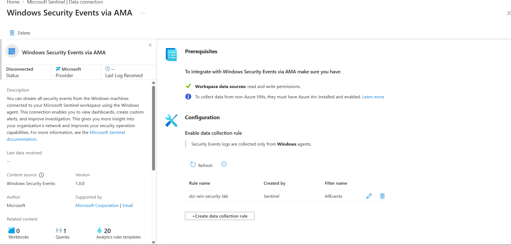
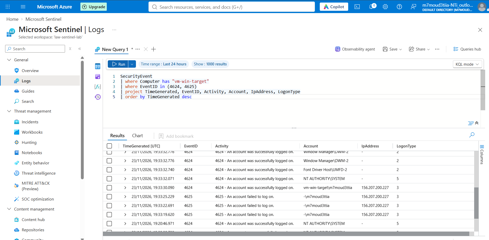

## Overview

In this part of the **Azure Cloud SOC Lab**, I set up the core Azure foundation under `RG-sentinel-lab` (`East US`), deployed a Log Analytics workspace (`law-sentinel-lab`) with a daily ingestion cap and Microsoft Sentinel, provisioned the Windows Server 2022 target machine (`vm-win-target`), connected it via a Data Collection Rule (`dcr-win-security-lab`), simulated failed and successful RDP logons from Kali Linux, and validated the incoming telemetry with KQL.

## 1. Azure Foundation, Log Analytics & Sentinel

I started by organizing the lab resources under a dedicated resource group (`RG-sentinel-lab`) in `East US` so all lab components stay isolated and easy to manage or clean up.

{: .normal }

Next, I deployed the Log Analytics workspace (`law-sentinel-lab`) inside `RG-sentinel-lab` to act as the underlying log storage engine for Microsoft Sentinel.

{: .normal }

To prevent unexpected ingestion charges during testing, I enabled a daily ingestion cap on `law-sentinel-lab` to control daily log volume.

{: .normal }

Finally, I onboarded **Microsoft Sentinel** onto `law-sentinel-lab` to enable threat hunting, KQL analytics, and incident management.

{: .normal }

## 2. Target VM Provisioning & RDP Hardening

I provisioned `vm-win-target` (Windows Server 2022 Datacenter, `Standard_D2alds_v7`) inside `RG-sentinel-lab` as the controlled target host, and restricted inbound RDP (`TCP/3389`) on its Network Security Group to my source IP address rather than exposing it to `Any`.

{: .normal }

## 3. Connecting `vm-win-target` to Sentinel via AMA & DCR

After installing the **Windows Security Events** solution from Content Hub, I created a Data Collection Rule (`dcr-win-security-lab`) under **Windows Security Events via AMA** associated with `vm-win-target` so Windows security events stream into `law-sentinel-lab`.

{: .normal }

## 4. Attack Simulation from Kali Linux

Using `FreeRDP` from Kali Linux, I tested failed authentication attempts followed by a successful RDP logon to `vm-win-target` (`20.121.139.112`) to generate realistic Windows authentication logs (`Event ID 4625` for failed logons and `Event ID 4624` for successful logons).

{: .normal }

## 5. Validating Telemetry & Failed Logon Patterns with KQL

Once events arrived in `law-sentinel-lab`, I queried `SecurityEvent` in **Logs** to verify individual `4625` and `4624` records along with `Account`, `IpAddress`, and `LogonType`.

~~~kusto
SecurityEvent
| where Computer has "vm-win-target"
| where EventID in (4624, 4625)
| project TimeGenerated, EventID, Activity, Account, IpAddress, LogonType
| order by TimeGenerated desc
~~~

{: .normal }

I then aggregated failed logon attempts (`EventID == 4625`) by `IpAddress` and `Account` to group repeated authentication failures—the foundational logic for a brute-force detection rule.

~~~kusto
SecurityEvent
| where Computer has "vm-win-target"
| where EventID == 4625
| summarize FailedAttempts = count(), LastAttempt = max(TimeGenerated) by IpAddress, Account
| where FailedAttempts >= 2
| order by FailedAttempts desc
~~~

{: .normal }

## What's Next

With log ingestion and KQL validation confirmed, the next step is building **Scheduled Analytics Rules** in Microsoft Sentinel and investigating the generated incidents.
