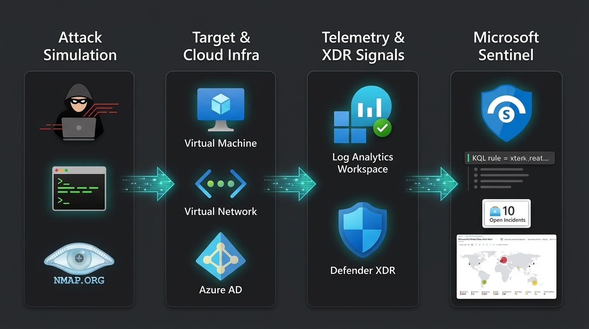

## Overview

As part of my preparation for the **Microsoft SC-200 (Security Operations Analyst)** certification and to deepen my practical skills in **Threat Hunting**, **Detection Engineering**, and **Incident Investigation**, I am building an end-to-end **Azure Cloud SOC Lab** from scratch.

The goal of this project is to simulate real-world attack techniques against an isolated cloud environment, collect telemetry across identity, network, and endpoint layers, and build actionable detections and automated response workflows.

## Lab Architecture

The architecture is divided into four core stages:

1. **Attack Simulation:** Using a Kali Linux environment to execute controlled reconnaissance, brute-force attempts, and identity enumeration (Nmap, BloodHound) strictly against isolated lab assets.
2. **Target & Cloud Infrastructure:** Hosting vulnerable/monitored cloud resources inside a dedicated Azure Resource Group, including a Virtual Network (VNet), a target Virtual Machine, and Microsoft Entra ID (Azure AD).
3. **Telemetry & XDR Signals:** Streaming security logs, Windows Security Events, Sysmon telemetry, Azure Activity Logs, and Microsoft Defender XDR alerts into a centralized **Log Analytics Workspace**.
4. **SIEM & SOAR (Microsoft Sentinel):** Writing custom **KQL Analytics Rules** mapped to **MITRE ATT&CK**, triaging generated incidents, hunting for anomalies, and automating response actions using Logic Apps Playbooks and Workbooks.

## Cost Control & Safety Guardrails

Before deploying any infrastructure, I established strict operational guardrails:
* **Resource Isolation:** All lab assets live inside a single dedicated Resource Group for clean management and instant teardown.
* **Ingestion & Compute Limits:** Configured a daily ingestion cap on the Log Analytics Workspace and enforced auto-shutdown schedules on all Virtual Machines.
* **Strict Scope:** All simulated attacks are strictly confined to my own isolated lab environment.

## What's Next?

In **Part 2**, I will build the core Azure infrastructure—creating the Resource Group, configuring the Log Analytics Workspace, enabling **Microsoft Sentinel**, and deploying the hardened target Virtual Machine.
