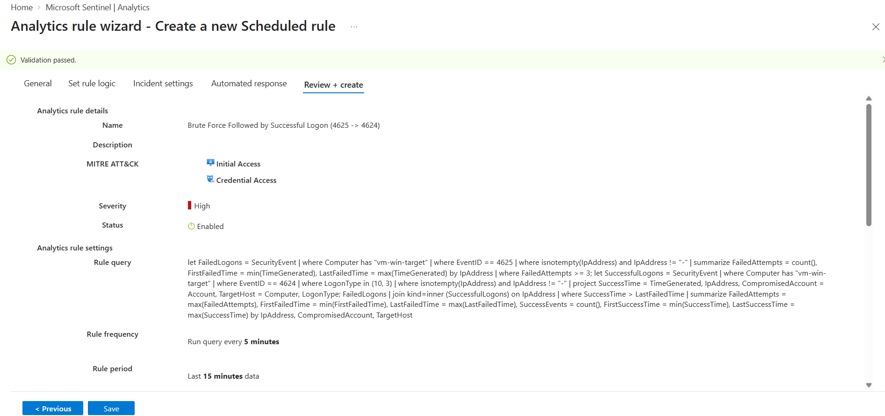
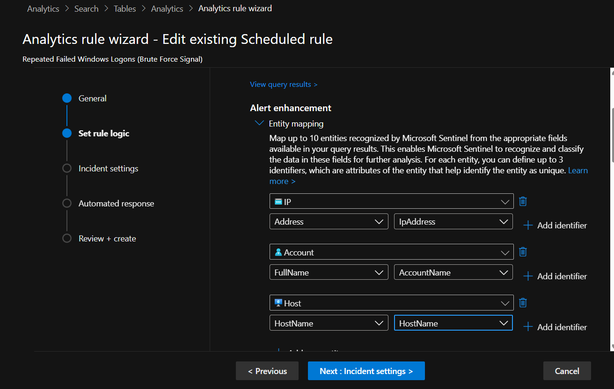
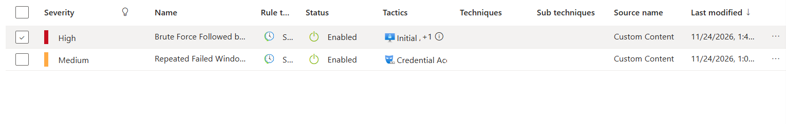
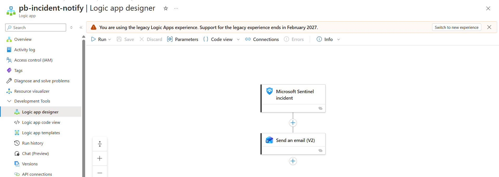
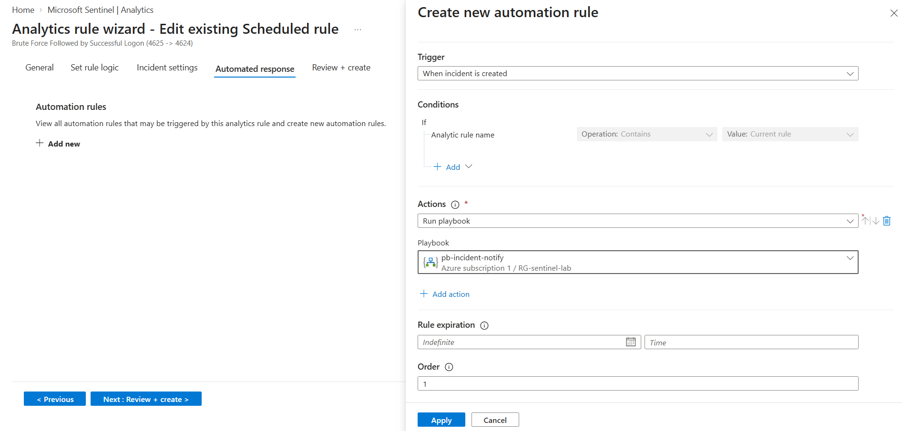
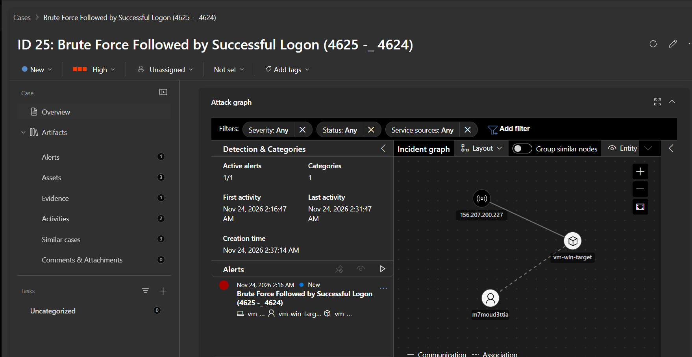
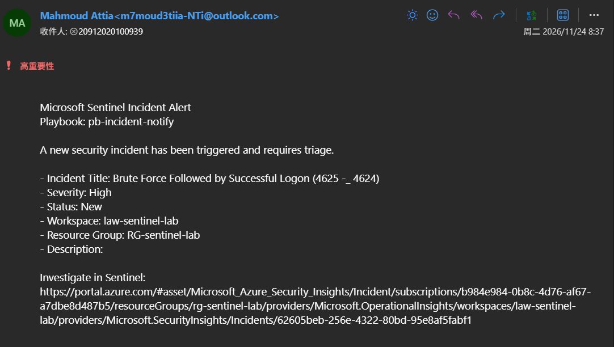

## Overview

In this part of the **Azure Cloud SOC Lab**, I moved from single-event alerts to **correlation detection** and **automated response** in Microsoft Sentinel. I built a **Scheduled Analytics Rule** (`Brute Force Followed by Successful Logon (4625 -> 4624)`) that detects repeated failed logons followed by a successful logon from the same source IP against `vm-win-target`, mapped its output fields to **Sentinel entities** (IP, Account, Host), created a Logic App playbook (`pb-incident-notify`) that emails the SOC on every new incident, connected it through an **automation rule**, and validated everything end to end with a simulated attack that produced **Incident ID 25**.

## 1. Building the Brute-Force-to-Success Correlation Rule

In Part 2, the rule `Repeated Failed Windows Logons (Brute Force Signal)` told us someone was *guessing* passwords. The question an analyst really needs answered next is: **did the guessing work?** A successful logon (`EventID 4624`) from the same IP *after* repeated failures (`EventID 4625`) is a much stronger indicator of compromise, so I built a second **Scheduled query rule** to catch exactly that pattern.

In **Microsoft Sentinel**, I went to **Analytics** → **+ Create** → **Scheduled query rule** and configured the rule:

* **Name:** `Brute Force Followed by Successful Logon (4625 -> 4624)`
* **Severity (`High`):** A failed-then-successful pattern means an attacker may already have valid credentials, so this deserves higher priority than the Part 2 rule (`Medium`).
* **Run query every:** `5 Minutes`
* **Lookup data from the last:** `15 Minutes`

### MITRE ATT&CK Alignment

* **Tactic — Initial Access (`TA0001`):** A successful remote logon after repeated failures suggests the adversary got into `vm-win-target` using a valid account.
* **Tactic — Credential Access (`TA0006`):** The failed attempts before the success show the credential guessing that made it possible.
* **Techniques:** The behavior lines up with **Brute Force (`T1110`)** followed by the use of **Valid Accounts (`T1078`)** over RDP.

### Rule Query & Logic

This query is a step up from Part 2 because it uses **two sub-queries** (`let` statements) and a **join** to combine them. Think of it as two assembly lines, one collecting the failures and one collecting the successes, that meet at a single checkpoint: the source IP.

~~~kusto
let FailedLogons = SecurityEvent
| where Computer has "vm-win-target"
| where EventID == 4625
| where isnotempty(IpAddress) and IpAddress != "-"
| summarize FailedAttempts = count(),
            FirstFailedTime = min(TimeGenerated),
            LastFailedTime = max(TimeGenerated)
  by IpAddress
| where FailedAttempts >= 3;
let SuccessfulLogons = SecurityEvent
| where Computer has "vm-win-target"
| where EventID == 4624
| where LogonType in (10, 3)
| where isnotempty(IpAddress) and IpAddress != "-"
| project SuccessTime = TimeGenerated,
          IpAddress,
          CompromisedAccount = Account,
          TargetHost = Computer,
          LogonType;
FailedLogons
| join kind=inner (SuccessfulLogons) on IpAddress
| where SuccessTime > LastFailedTime
| summarize FailedAttempts = max(FailedAttempts),
            FirstFailedTime = min(FirstFailedTime),
            LastFailedTime = max(LastFailedTime),
            SuccessEvents = count(),
            FirstSuccessTime = min(SuccessTime),
            LastSuccessTime = max(SuccessTime)
  by IpAddress, CompromisedAccount, TargetHost
| extend AccountName = CompromisedAccount, HostName = TargetHost
~~~

#### Step-by-Step Breakdown for KQL Beginners

1. **`let FailedLogons = ...`** — Creates a reusable, named result set. It filters `SecurityEvent` to failed logons (`EventID 4625`) on `vm-win-target`, removes blank or `"-"` IP addresses, then groups by `IpAddress` to count `FailedAttempts` and capture `FirstFailedTime` and `LastFailedTime`. The final `where FailedAttempts >= 3` keeps only IPs with 3 or more failures.
2. **`let SuccessfulLogons = ...`** — Creates a second result set for successful logons (`EventID 4624`). The filter `LogonType in (10, 3)` keeps only **Remote Interactive / RDP (10)** and **Network (3)** logons. `project` then renames the fields we need: `SuccessTime`, `CompromisedAccount` and `TargetHost`.
3. **`FailedLogons | join kind=inner (SuccessfulLogons) on IpAddress`** — Connects the two result sets. An `inner` join keeps only IPs that appear in **both**, meaning IPs that failed repeatedly *and* also logged on successfully.
4. **`| where SuccessTime > LastFailedTime`** — Enforces the order of events. The success must happen **after** the last failure, which filters out earlier, legitimate sessions from the same IP.
5. **`| summarize ... by IpAddress, CompromisedAccount, TargetHost`** — Collapses the matches into one row per IP, account and host, with the failure count, success count and time windows for the analyst.
6. **`| extend AccountName = CompromisedAccount, HostName = TargetHost`** — Creates columns named exactly `AccountName` and `HostName`, so they can be mapped as **Account** and **Host** entities in the next step.

After the query, I went through **Incident settings** and **Automated response**, then **Review + create**. The wizard showed **Validation passed**, with `High` severity, `Enabled` status, a 5-minute frequency and a 15-minute lookback.

{: .normal }

## 2. Configuring Entity Mapping

At the end of Part 2, the incident showed `No entities` and `Assets: 0`, because the rule had no entity mapping. **Entity mapping** tells Microsoft Sentinel which query fields are IPs, accounts and hosts, so alerts and incidents link them together and the attack graph can be built.

Inside **Set rule logic**, I expanded **Alert enhancement** → **Entity mapping** and added three entities:

| Entity | Identifier | Field |
|---------|------------|---------------|
| IP | Address | `IpAddress` |
| Account | FullName | `AccountName` |
| Host | HostName | `HostName` |

{: .normal }

> **Key point:** Entity mapping only works if the mapped field names **exactly match** the query output. That is why the query ends with the `extend` line that creates `AccountName` and `HostName`. Without it, the mappings would point to fields that do not exist and the entities would come up empty.
{: .prompt-tip }

With both rules saved, the **Analytics** table now shows the new `High` severity correlation rule alongside the earlier `Medium` brute-force signal rule, both `Enabled`.

{: .normal }

## 3. Building the `pb-incident-notify` Playbook & Automation Rule

Detection alone is not enough, because someone has to see the incident. I automated notification with an **Azure Logic App playbook** (`pb-incident-notify`) in resource group `RG-sentinel-lab`.

### Designing the Playbook

1. Created a playbook with a **Microsoft Sentinel incident** trigger.
2. In the Logic App designer, added a **Send an email (V2)** action below the trigger.
3. Filled the email subject and body with dynamic incident fields (**Incident Title**, **Severity**, **Status**, **Description** and **Incident URL**) along with the workspace details (`law-sentinel-lab`, `RG-sentinel-lab`).
4. Saved the playbook.

{: .normal }

> **Troubleshooting:** Pairing the `azuresentinel` connector with the shared Gmail connector triggered a `GmailConnectorPolicyViolation` error during validation. Switching to the **Send an email (V2)** action passed workflow validation cleanly.
{: .prompt-warning }

### Connecting the Playbook with an Automation Rule

A playbook does nothing until something triggers it, so I attached it to the rule through an **automation rule**:

1. Opened the analytics rule → **Automated response** → **+ Add new**.
2. When `pb-incident-notify` showed **No Microsoft Sentinel permissions**, I clicked **Manage playbook permissions** and granted Sentinel permission to run it.
3. Configured the automation rule:
   * **Trigger:** `When incident is created`
   * **Conditions:** `Analytic rule name` `Contains` `Current rule`
   * **Actions:** `Run playbook` → `pb-incident-notify`
   * **Order:** `1`
4. Clicked **Apply**, then completed **Review + create** and saved the rule.

{: .normal }

## 4. Validating the Attack Simulation (`Incident ID 25`)

With the VM running, I repeated the attack simulation from Kali Linux (`156.207.200.227`): several failed RDP logons against `vm-win-target`, followed by a successful logon. Sentinel triggered the new rule and generated **Case `ID 25: Brute Force Followed by Successful Logon`** with **High** severity and **New** status.

{: .normal }

> The incident title shows `4625 -_ 4624` instead of `4625 -> 4624`. Sentinel replaced the `>` character in the rule name. Renaming the rule to something like `4625 to 4624` avoids this.
{: .prompt-info }

Right after the incident was created, the automation rule ran `pb-incident-notify` and the alert email arrived with the incident title, severity, status, workspace, resource group and a direct link to the incident in Sentinel.

{: .normal }

### Triage Takeaways

1. **Entity Mapping Worked:** Compared with Incident 19 in Part 2 (`No entities`, `Assets: 0`), Incident 25 shows `3` assets and an attack graph linking the source IP `156.207.200.227` to the target host `vm-win-target` and the account `m7moud3ttia`.
2. **Timeline Verification:** The incident shows `1/1` active alert, `1` evidence item and `2` activities, with first activity at `Nov 24, 2026 2:16:47 AM` and last activity at `2:31:47 AM`.
3. **Automation Verified End to End:** The chain of correlation rule → incident → automation rule → playbook → email worked without any manual step. The email arrived with the same details an analyst needs to start triage.
4. **Next Analyst Step:** Because a successful logon followed the failures, a real analyst would now treat the account as potentially compromised, reviewing what that session did and resetting the credentials.

topic here]*.
